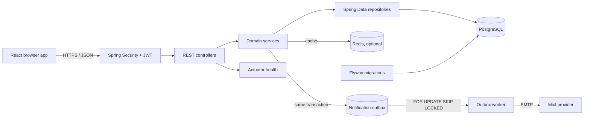
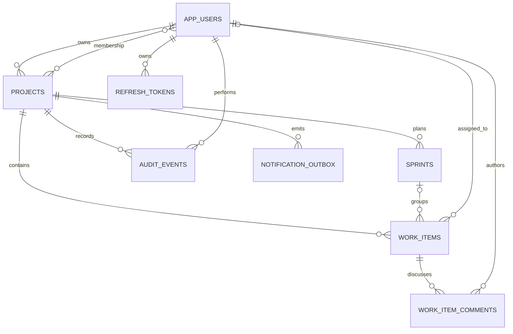

# SprintForge

   

SprintForge is a project-delivery workspace for teams planning sprints, assigning work, and tracking changes. It is a Java/Spring modular monolith with a React frontend and a REST API backed by PostgreSQL.

## Features

- React application for projects, Kanban work, sprints, discussions, audit history, team members, and administration
- Registration and login using BCrypt, HS256 access tokens, and rotating opaque refresh tokens
- Five failed login attempts per email address in a 15-minute window trigger a temporary `429 Too Many Requests`
- Global `ADMIN > MANAGER > USER` roles plus project ownership and membership policies
- Project, sprint, and work-item workflows with validation, optimistic locking, and archived-project write protection
- Searchable and paginated work items with status/priority filters and cached board summaries
- Comment timelines with author editing and owner moderation; append-only project audit history
- Transactional email outbox with stable idempotency keys, coordinated workers, bounded retries, dead-lettering, and admin replay
- Health probes, Docker Compose, Flyway migrations, JaCoCo, PostgreSQL Testcontainers, and Trivy image scanning

## Architecture

The browser UI and REST API are served by the same Spring Boot application in production. Domain modules share a transaction boundary; notification delivery is moved off the request path through a database outbox.



```text
src/main/java/dev/divyansh/sprintforge/
├── auth/          registration, login, JWT and refresh rotation
├── audit/         append-only project history
├── comment/       work-item discussions and moderation
├── config/        security, health, scheduling and SPA fallback
├── notification/  transactional outbox, worker, admin replay
├── project/       ownership, membership and access policies
├── sprint/        sprint planning and lifecycle rules
├── task/          work-item workflow, search and summaries
└── user/          identity, roles and optional admin bootstrap

frontend/src/
├── api/           authenticated REST client
├── components/    app shell, shared controls and work-item drawer
├── context/       session state
└── pages/         login, projects, board, sprints, audit, members, admin
```

See the [architecture reference](docs/architecture.md) for request flow, module responsibilities, consistency rules, and design tradeoffs.

## Technology stack

| Area | Technology |
| --- | --- |
| Backend | Java 21, Spring Boot 4, Spring MVC, Bean Validation |
| Frontend | React 19, Vite, JSX, React Router, plain CSS |
| Security | Spring Security, HS256 JWT, refresh-token rotation, BCrypt |
| Persistence | Spring Data JPA, Hibernate, PostgreSQL 17, Flyway |
| Reliability | Transactional outbox, bounded retries, Redis cache, optimistic locking |
| Integrations | SMTP email; Redis is optional |
| Testing | JUnit 5, MockMvc, Mockito, H2, PostgreSQL Testcontainers, JaCoCo |
| Operations | Docker Compose, Actuator health, GitHub Actions, Trivy |

## Data model



Flyway migrations are in [`src/main/resources/db/migration`](src/main/resources/db/migration). Hibernate validates the migrated schema on startup.

## Application routes

| Page | Route |
| --- | --- |
| Login / register | `/login` |
| Project list | `/projects` |
| Project overview | `/projects/:projectId` |
| Kanban board and work-item drawer | `/projects/:projectId/board` |
| Sprints | `/projects/:projectId/sprints` |
| Members | `/projects/:projectId/members` |
| Audit history | `/projects/:projectId/audit` |
| Admin console | `/admin` (ADMIN role) |

## REST API

All API routes are under `/api/v1`. Protected requests use `Authorization: Bearer <access-token>`.

| Method | Endpoint | Access | Purpose |
| --- | --- | --- | --- |
| `POST` | `/auth/register` | Public | Register and issue tokens |
| `POST` | `/auth/login` | Public | Sign in; throttled after failed attempts |
| `POST` | `/auth/refresh` | Public | Rotate a refresh token |
| `POST` | `/auth/logout` | Public | Revoke a refresh token |
| `GET` | `/auth/me` | Authenticated | Return the current profile |
| `GET` | `/projects` | Authenticated | List accessible projects |
| `POST` | `/projects` | Authenticated | Create a project |
| `GET` | `/projects/{id}` | Member | Read project details |
| `GET` | `/projects/{id}/members` | Member | List project members |
| `POST` | `/projects/{id}/members/{email}` | Owner | Add a registered member |
| `PATCH` | `/projects/{id}/archive` | Owner | Archive a project |
| `GET`, `POST` | `/projects/{id}/sprints` | Member | List or create sprints |
| `PATCH` | `/projects/{id}/sprints/{sprintId}/status` | Member | Advance or cancel a sprint |
| `GET`, `POST` | `/projects/{id}/work-items` | Member | Search, page, or create work |
| `PUT`, `DELETE` | `/projects/{id}/work-items/{workItemId}` | Member | Update or soft-delete work |
| `GET` | `/projects/{id}/work-items/summary` | Member | Count work by status |
| `GET`, `POST` | `/projects/{id}/work-items/{workItemId}/comments` | Member | Read or add comments |
| `PATCH`, `DELETE` | `/projects/{id}/work-items/{workItemId}/comments/{commentId}` | Author / owner | Edit or soft-delete a comment |
| `GET` | `/projects/{id}/audit-events` | Member | Read project audit history |
| `GET` | `/admin/outbox` | Admin | Inspect notification events |
| `POST` | `/admin/outbox/{id}/replay` | Admin | Replay a dead-lettered event |
| `PATCH` | `/admin/users/{userId}/role` | Admin | Change a user's global role |
| `GET` | `/actuator/health` | Public | Health and readiness status |

Work-item searches accept `status`, `priority`, and `q`. Pageable endpoints accept Spring `page`, `size`, and `sort` parameters. Swagger UI is at `/docs`; the OpenAPI document is at `/v3/api-docs`.

## Run locally

For step-by-step setup, day-to-day operation, testing, troubleshooting, and publishing to a clean Git repository, see the [Operations Guide](docs/OPERATIONS_GUIDE.md).

### Docker Compose

Requirements: Docker Engine with Compose.

```bash
docker compose up --build
```

Open the application at [http://localhost:8080](http://localhost:8080). Compose starts the API, PostgreSQL, and Redis. Flyway applies migrations, while Hibernate validates the schema. Stop the stack with `docker compose down`; add `-v` only when intentionally deleting local database data.

### Backend with Maven

Requirements: Java 21 and PostgreSQL 17. Create a local database, set `DATABASE_URL`, `DATABASE_USERNAME`, `DATABASE_PASSWORD`, and a non-default `JWT_SECRET`, then run:

```powershell
.\mvnw.cmd spring-boot:run
```

### Frontend development server

Start the backend on port 8080, then run:

```powershell
cd frontend
npm ci
npm run dev
```

Vite serves the UI on port 5173 and proxies `/api` and `/actuator` requests to the backend.

## Environment variables

The [`.env.example`](.env.example) file lists local configuration samples. Replace example secrets before any internet-facing deployment.

| Variable | Description |
| --- | --- |
| `DATABASE_URL`, `DATABASE_USERNAME`, `DATABASE_PASSWORD` | PostgreSQL JDBC connection and credentials |
| `JWT_SECRET` | HS256 signing secret; production must not use the development default |
| `REFRESH_TOKEN_TTL` | Refresh-token lifetime, ISO-8601 duration; defaults to 30 days |
| `CACHE_TYPE` | `simple` for local cache or `redis` for Redis |
| `EMAIL_NOTIFICATIONS_ENABLED` | Enable outbound notification mail |
| `OUTBOX_WORKER_ENABLED` | Enable the notification worker; defaults to true |
| `OUTBOX_BATCH_SIZE` | Maximum events claimed per worker batch |
| `OUTBOX_MAX_ATTEMPTS` | Attempts before an event is marked dead |
| `OUTBOX_POLL_DELAY`, `OUTBOX_INITIAL_DELAY` | Worker polling and startup delay |
| `OUTBOX_RETRY_BASE`, `OUTBOX_RETRY_MAXIMUM` | Bounded exponential retry delays |
| `MAIL_HOST`, `MAIL_PORT`, `MAIL_USERNAME`, `MAIL_PASSWORD` | SMTP connection settings |
| `MAIL_FROM`, `MAIL_AUTH`, `MAIL_STARTTLS` | SMTP sender and security settings |
| `BOOTSTRAP_ADMIN_ENABLED` | Enable optional creation of an initial admin |
| `BOOTSTRAP_ADMIN_EMAIL`, `BOOTSTRAP_ADMIN_PASSWORD`, `BOOTSTRAP_ADMIN_NAME` | Initial admin identity; use a strong unique password |
| `PORT` | HTTP server port; defaults to 8080 |

Bootstrap admin creation is disabled unless explicitly enabled. Use it only during initial provisioning and keep the credentials secret.

## Notification outbox

Project membership and notification intent are committed in one database transaction. Workers claim rows using PostgreSQL `FOR UPDATE SKIP LOCKED`; stable idempotency keys help prevent duplicate delivery. Transient failures use bounded exponential backoff. Events that exhaust their attempts enter `DEAD` and can be inspected and replayed by an admin using `POST /api/v1/admin/outbox/{id}/replay`. Delivery is at-least-once at the external SMTP boundary.

## Tests, CI, and performance

```powershell
.\mvnw.cmd clean verify
```

The suite exercises unit and H2 integration behavior plus PostgreSQL migration verification through Testcontainers. JaCoCo reports are written to `target/site/jacoco`. CI runs Maven verification, builds the production container, and scans it with Trivy for high and critical vulnerabilities. Release automation publishes GitHub releases for version tags.

The [performance guide](docs/performance.md) documents k6 `smoke` and `load` profiles. The workflow is manually triggered and stores raw summaries; no performance figures are claimed without a completed run.

## Deployment

[`render.yaml`](render.yaml) describes the Render Docker service and managed PostgreSQL database. The health check uses `/actuator/health`. Free instances may spin down while idle.

## License and attribution

Licensed under the [MIT License](LICENSE).

Based on SprintForge by Goureesankar S Nair (MIT License).
