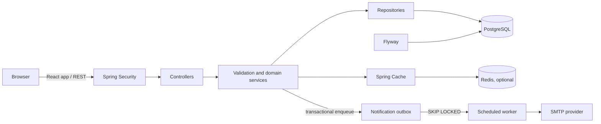
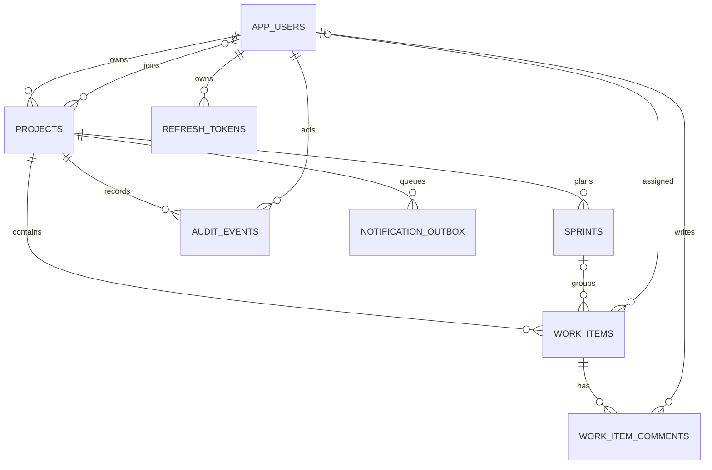
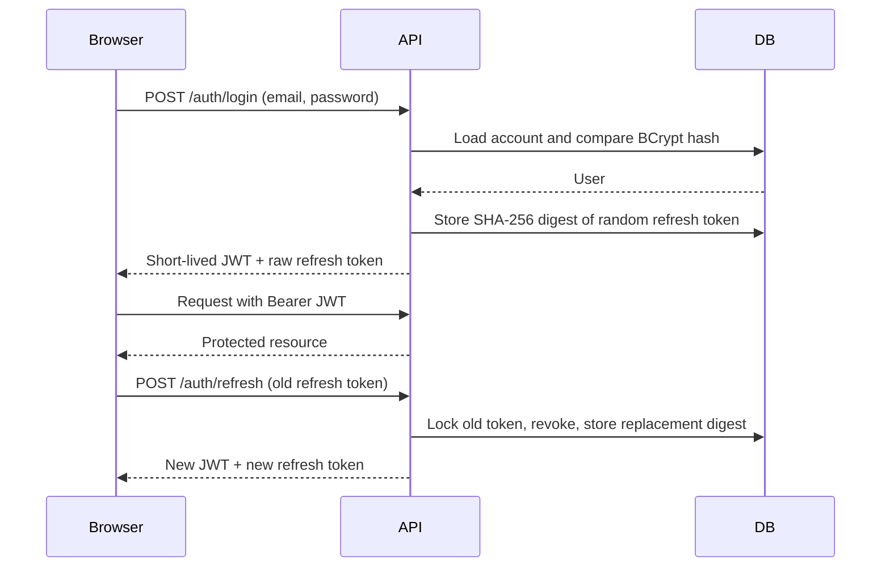

# SprintForge Project Guide

This guide explains the current SprintForge codebase for someone new to the project. Start with the [README](../README.md) for commands and API routes, then use this guide to understand how the pieces fit together.

## 1. What SprintForge does

SprintForge is a team project-delivery application. A user creates a project, adds colleagues, plans sprints, and tracks work items through a Kanban workflow. Changes are recorded in an audit log. Project invitations are delivered by email through a transactional outbox.

The application is a **modular monolith**: one Spring Boot process contains multiple capability-focused packages. This keeps deployment simple while retaining clear boundaries between authentication, projects, work items, sprints, comments, notifications, and audit history.

## 2. What changed and why

The simplification removed optional or unused operational surface area:

- **S3 attachment support** was removed because attachments were disabled and no client consumed the upload flow. This avoids carrying an unused cloud SDK and schema.
- **WebSocket/STOMP updates** were removed because there was no realtime client. REST is the single application interface.
- **Prometheus/Grafana instrumentation** was removed to reduce local deployment and configuration overhead. Actuator health remains for deployment readiness.
- **Stress k6 profile** was removed. The repeatable smoke and steady-load profiles remain.
- **SonarCloud, SpotBugs, and OWASP Dependency-Check integration** were removed from this project setup. Maven verification, JaCoCo, and Trivy image scanning remain in CI.

Application improvements add the missing product surfaces and close workflow gaps:

- A React/Vite browser UI provides project, board, sprint, comment, audit, member, and admin screens.
- A status omitted from a work-item update now stays unchanged.
- Refresh-token failures have an accurate error message.
- Production refuses the known development JWT secret.
- Archived projects reject new work items and sprints.
- Members can view their own profile and project members.
- Login attempts are limited to five attempts per email in a 15-minute window, and successful login clears that email's counter.
- An optional bootstrap-admin configuration makes initial setup easier.

## 3. Technology overview

| Technology | What it does here |
| --- | --- |
| Java 21 | Backend language and runtime |
| Spring Boot 4 | Application startup, configuration, and dependency wiring |
| Spring MVC | REST controllers and JSON HTTP endpoints |
| Spring Security | Stateless endpoint authorization and JWT validation |
| JWT / HS256 | Signs short-lived access tokens; API clients send them as bearer tokens |
| BCrypt | Stores password hashes rather than plain-text passwords |
| Spring Data JPA / Hibernate | Maps Java entities to database tables and implements repositories |
| PostgreSQL 17 | Durable relational storage and outbox row locking |
| Flyway | Applies ordered, versioned schema changes |
| Redis / Spring Cache | Optional shared cache for board summaries |
| React + JSX | Frontend screens and interactive components |
| Vite | Frontend development server and production bundler |
| SMTP | External delivery channel for invitation email |
| Docker Compose | Runs the API, PostgreSQL, and Redis locally |
| JUnit, Mockito, MockMvc | Unit and HTTP-level backend tests |
| Testcontainers | Runs migration verification against PostgreSQL |
| JaCoCo | Produces test coverage reports |
| Trivy | Scans the built application image in CI |

## 4. High-level architecture

In production, the same Spring Boot app serves the compiled frontend assets and the REST API. During development, Vite serves the UI separately and proxies API requests to the backend.

## 5. Request flow walkthrough

For a signed-in request such as creating a work item:

1. The browser sends `POST /api/v1/projects/{projectId}/work-items` with a JSON body and `Authorization: Bearer <token>`.
2. Spring Security validates the JWT signature, expiry, and claims. The security context exposes the authenticated principal.
3. Spring MVC finds the `WorkItemController` mapping and deserializes the JSON request.
4. Bean Validation checks required fields, for example a nonblank title and a valid priority.
5. The controller asks `ProjectAccessService` to confirm membership and that the project is writable.
6. `WorkItemController` calls repositories and workflow services to verify related users/sprints, create the entity, and append an audit event.
7. The repository writes are committed together by the transaction boundary.
8. The controller returns a JSON view. `ApiExceptionHandler` converts validation and domain failures into the common problem response shape.

The controller handles HTTP translation, the service owns business rules, and the repository owns persistence queries. Keeping these responsibilities separate makes business rules testable without starting the web server.

## 6. Data model

Projects own the shared work boundary. Sprints and work items reference a project; a work item may optionally reference a sprint and an assignee. Comments belong to a work item. Audit events record important changes. Refresh tokens and outbox events have their own lifecycle.

Flyway SQL migrations are in `src/main/resources/db/migration`. Production Hibernate configuration validates the schema rather than generating it.

## 7. Authentication and refresh rotation

The database stores only a SHA-256 digest of each random refresh token. On refresh, the old row is revoked and replaced. Reusing a revoked token is rejected. Access tokens are stateless and expire after their configured lifetime.

Login throttling is process-local memory: five attempted logins for the same normalized email are allowed during a fixed 15-minute window; another attempt receives HTTP 429. A successful login clears that email's window. This is a basic single-instance control, not a substitute for a distributed rate limiter behind multiple API replicas.

## 8. Transactional email outbox

When the application needs to send an invitation, it creates the outbox row in the same database transaction as the membership change. If the transaction rolls back, the notification intent rolls back too.

The scheduled worker:

1. Selects due rows with PostgreSQL `FOR UPDATE SKIP LOCKED`, so concurrent workers claim different rows.
2. Marks a row as processing and increments the attempt count.
3. Sends the email through the configured SMTP provider.
4. Marks success as processed, or records an error and schedules a bounded exponential retry.
5. Moves exhausted failures to `DEAD`.

Rows have a stable unique idempotency key. External email delivery is at-least-once: the database coordinates application workers, but an SMTP provider can accept a message even if the worker loses its connection before recording success. Admins can inspect failures and replay a dead-lettered event through `POST /api/v1/admin/outbox/{id}/replay`.

## 9. Frontend structure

`frontend/src` is plain JavaScript and JSX (not TypeScript):

- `api/client.js` centralizes JSON requests and bearer-token headers.
- `context/AuthContext.jsx` stores login state in browser local storage.
- `components/AppShell.jsx` provides navigation and the signed-in layout.
- `components/WorkItemDrawer.jsx` edits work items and manages their discussions.
- `pages/` contains route-level screens for auth, projects, board, sprints, audit history, members, and admin operations.
- `styles.css` contains the responsive visual system without a component-library dependency.

The Vite proxy forwards `/api` and `/actuator` calls to `localhost:8080`. In the Docker image, Vite builds static assets; the Docker build copies those assets into Spring Boot's static resources before packaging the JAR.

## 10. CI pipeline

The main CI workflow:

1. Checks out the source and configures Java 21 with Maven caching.
2. Runs `./mvnw --batch-mode verify` (tests, PostgreSQL migration verification where Docker is available, and JaCoCo).
3. Builds the production Docker image.
4. Scans it with Trivy and uploads security findings to GitHub.

The release workflow creates GitHub releases for version tags. The manual performance workflow runs the k6 smoke or load profile against a supplied deployment and uploads the raw summary.

## 11. Glossary

| Term | Meaning |
| --- | --- |
| Access token | Short-lived JWT attached to a protected API request |
| Refresh token | Random opaque credential used to request a new token pair |
| Idempotency key | Stable identifier used to recognize one logical delivery |
| Outbox | Database table storing external work that must follow a committed transaction |
| Dead letter | Outbox event that exhausted its configured retry attempts |
| `SKIP LOCKED` | PostgreSQL row-locking option that lets workers skip work claimed elsewhere |
| Soft delete | Marking a record deleted without physically erasing its history |
| Optimistic locking | Version check that detects a conflicting concurrent update |
| DTO / view | API-specific shape used to receive or return JSON |
| Flyway migration | Ordered SQL change applied to move the database schema forward |
| SPA fallback | Returning the app's `index.html` for browser routes handled by React Router |

## 12. Interview questions and concise answers

1. **Why use a modular monolith?** It keeps deployment and transactions simple while package boundaries make business capabilities clear.
2. **Why store a refresh-token hash?** A database leak should not reveal a bearer token that can be used directly.
3. **How does token rotation work?** The old refresh row is revoked and a replacement digest is stored in one transaction.
4. **Why BCrypt for passwords?** It is a salted, deliberately slow password-hashing algorithm designed to make offline guessing more expensive.
5. **How are project resources protected?** The API checks project membership and ownership before returning or mutating scoped data.
6. **Why return 404 for a non-member?** It avoids confirming that another user's project identifier exists.
7. **What is the outbox pattern?** Persisting external-work intent in the business transaction, then delivering it asynchronously.
8. **Why `FOR UPDATE SKIP LOCKED`?** It allows multiple workers to claim different due rows without waiting on rows already claimed.
9. **What delivery guarantee does the outbox provide?** At-least-once processing at the SMTP boundary; idempotency keys and safe state transitions reduce duplicates.
10. **How do retries avoid hammering SMTP?** A bounded exponential backoff increases delay between failed attempts and caps the maximum wait.
11. **Why use Flyway if Hibernate can create schemas?** Explicit migrations are reviewable, repeatable, and safer for production data.
12. **What does optimistic locking protect against?** It detects a write based on stale entity state instead of silently overwriting a concurrent update.
13. **Why keep audit events?** They preserve a durable record of important state changes alongside the transaction that caused them.
14. **How is the frontend deployed with the API?** Vite builds static assets that are copied into the Spring Boot JAR; React Router paths use an SPA fallback.
15. **What is the limitation of the login rate limiter?** It is process-local, so multiple replicas do not share counters; a distributed deployment needs a shared limiter such as Redis or a gateway policy.
